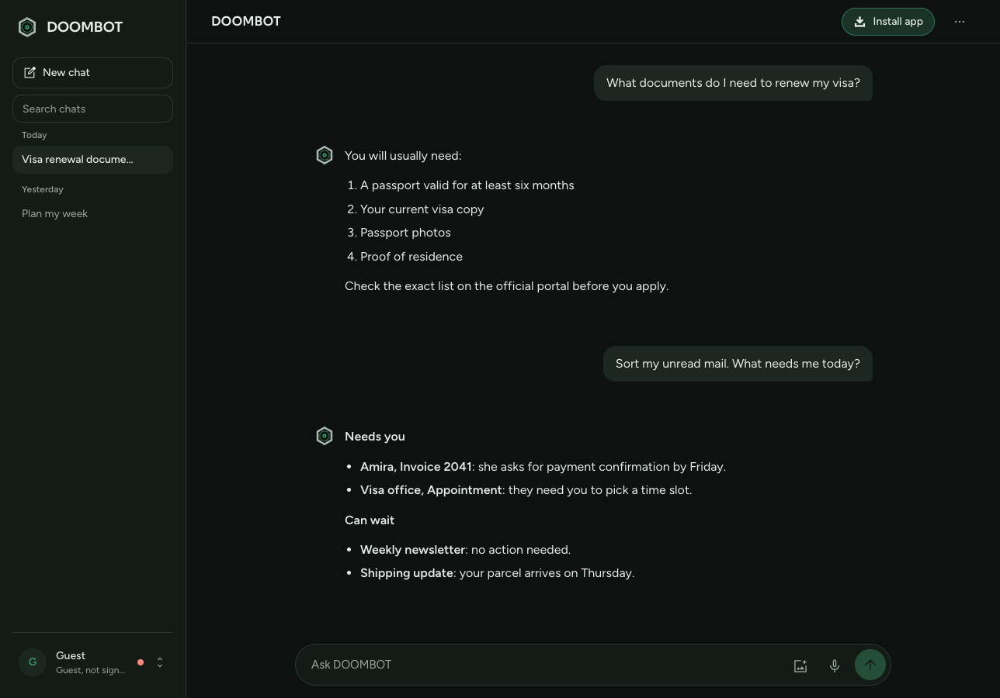
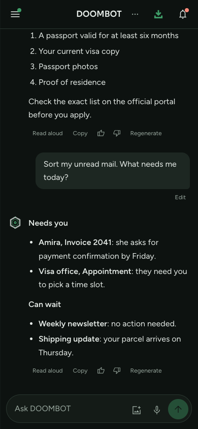
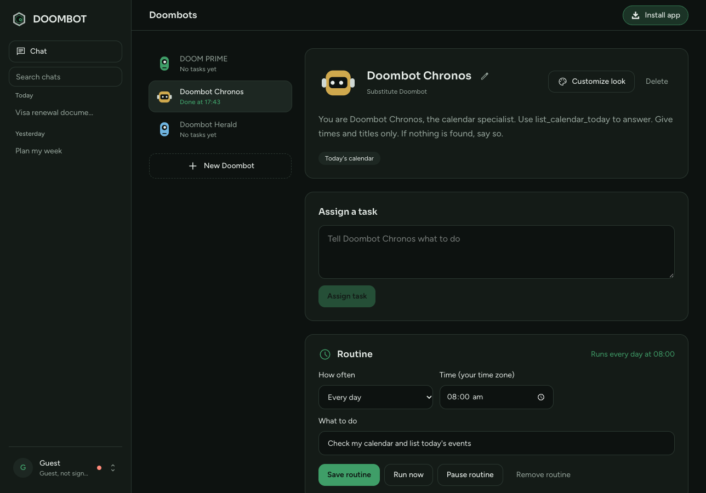
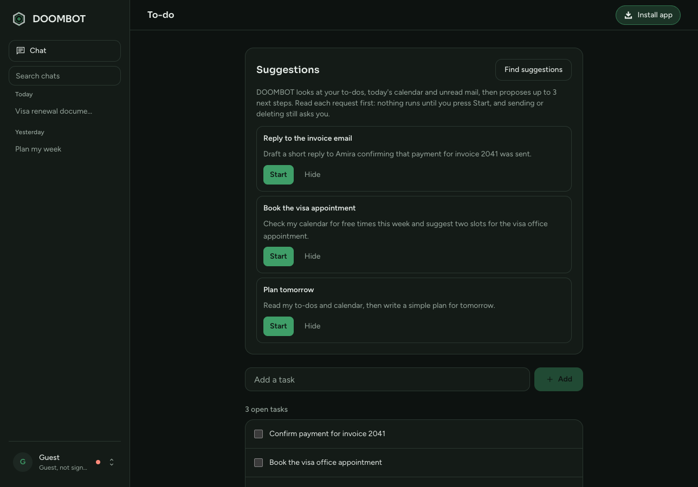
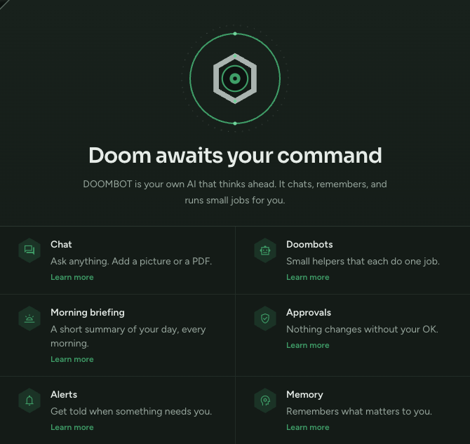
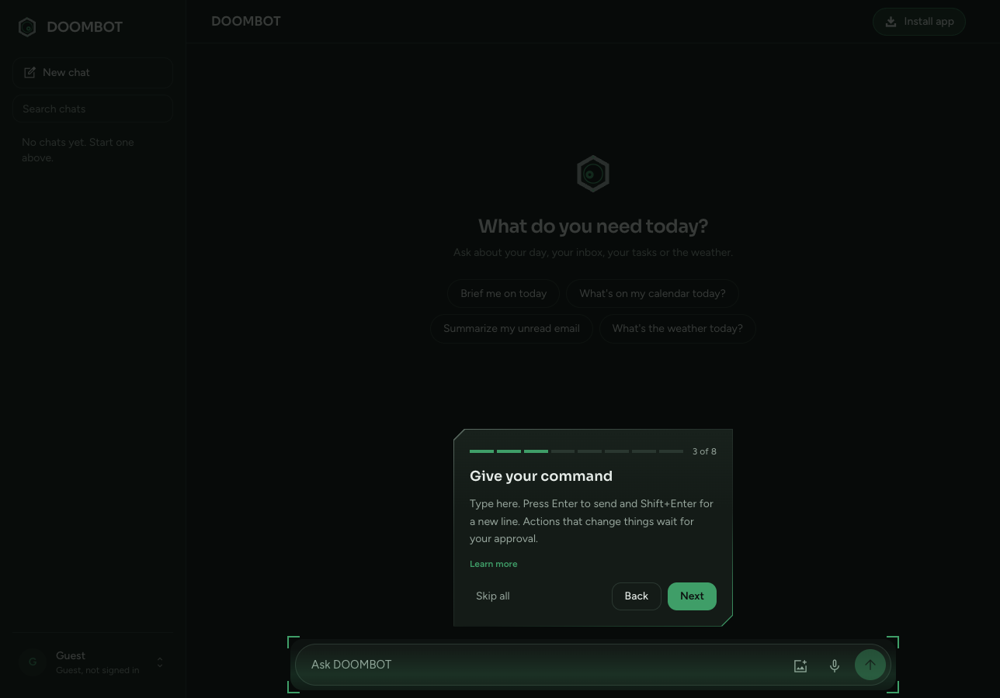

<div align="center">


# DOOMBOT

A personal AI agent that acts for you, with your approval.

[Live app](https://doom-bots.onrender.com/) · [Features](#features) · [Screenshots](#screenshots) · [Run locally](#run-locally) · [Deploy free](#deploy-free-on-render-with-turso)

[](https://nextjs.org)
[](https://www.typescriptlang.org)
[](https://turso.tech)
[](https://render.com)
[](./LICENSE)

</div>

---

## Overview

DOOMBOT is a chat assistant that does real tasks: it reads your calendar, mail and to-dos, searches the web, and runs helpers called Doombots. Before it sends, deletes or saves anything, it shows you the exact action and waits for your approval.

Each person signs in with Google and gets a private account. The app runs free on Render with a Turso database.

## Features

| Feature | Description |
| --- | --- |
| Chat | Streaming replies, multiple chats, search, edit and regenerate |
| Approvals | Risky actions wait for **Approve** or **Deny**, with the full text shown first |
| Email | Sort unread mail into *Needs you* and *Can wait*, and send an email after approval |
| Skills | Save your own steps once, then run them with `/name` in chat |
| Suggestions | Next steps from your to-dos, calendar and mail, with **Start** and **Hide** |
| Morning briefing | Weather, headlines, calendar, mail and to-dos at 07:00 |
| Doombots | Helpers with their own memory, tasks and routines |
| To-do | A task list that DOOMBOT and its Doombots can read and update |
| Memory and settings | Facts you choose to keep, custom instructions, time zone and home city |
| Install | Add it to your phone or desktop as an app |

## Screenshots

<table>
  <tr>
    <td align="center" width="66%"><br><sub>Chat</sub></td>
    <td align="center" width="34%"><br><sub>Chat on a phone</sub></td>
  </tr>
  <tr>
    <td align="center"><br><sub>Doombots</sub></td>
    <td align="center"><br><sub>To-do and suggestions</sub></td>
  </tr>
</table>

### Getting started

<table>
  <tr>
    <td align="center" width="50%"><br><sub>Welcome: choose what DOOMBOT covers</sub></td>
    <td align="center" width="50%"><br><sub>Guided tour: each step explains one part of the app</sub></td>
  </tr>
</table>

## Run locally

You need Node 22.13 or newer.

```bash
npm install
cp .env.example .env.local
npm run dev
```

The default `TURSO_DATABASE_URL=file:data/agent.db` keeps data in a local file. Fill in `.env.local`, then open http://localhost:3000.

| Setting | What it is |
| --- | --- |
| `GROQ_API_KEY` | Main AI provider. Has a free plan |
| `GEMINI_API_KEY`, `MISTRAL_API_KEY`, `OPENROUTER_API_KEY`, `DEEPSEEK_API_KEY` | Backup providers, used in order when Groq fails |
| `GOOGLE_CLIENT_ID`, `GOOGLE_CLIENT_SECRET` | Google sign-in, plus Calendar, Gmail and Tasks |
| `AUTH_SECRET` | At least 32 random characters. Make one with `openssl rand -hex 32` |
| `APP_URL` | The public address of the app, with no trailing slash |
| `TURSO_DATABASE_URL`, `TURSO_AUTH_TOKEN` | The Turso database address and token |
| `CRON_SECRET` | At least 16 random characters, protects `/api/cron` |
| `DAILY_TOKEN_LIMIT` | Tokens each account may use per day |

```bash
npm test
```

## Deploy free on Render with Turso

Render's free plan sleeps after 15 minutes without visitors and wipes its disk. Turso keeps the data, and a free cron job keeps the app awake for the 07:00 briefing and routines.

1. **Turso:** sign up at https://turso.tech, create a database, and copy its `libsql://` URL and a token.
2. **Render:** choose **New → Blueprint** and pick this repository. Fill in `TURSO_DATABASE_URL`, `TURSO_AUTH_TOKEN`, the Google values and the AI keys. After the first deploy, set `APP_URL` to your service address and redeploy.
3. **cron-job.org:** create a free job for `https://YOUR-ADDRESS/api/cron` every 5 minutes, with the header `Authorization: Bearer YOUR_CRON_SECRET`.
4. **Google Cloud:** add these redirect URIs to your OAuth client:
   - `https://YOUR-ADDRESS/api/auth/google/callback`
   - `https://YOUR-ADDRESS/api/google/callback`

Sending email needs one more permission. If you connected Google before this feature existed, open **Connections** and connect Google again.

## Safety and privacy

- Actions that send, save or delete wait for your approval, and the full text is shown first.
- Text from email, calendar and web pages is treated as data, never as instructions.
- Accounts are private, and you can erase all your data from Settings.

## License

[MIT](./LICENSE)
