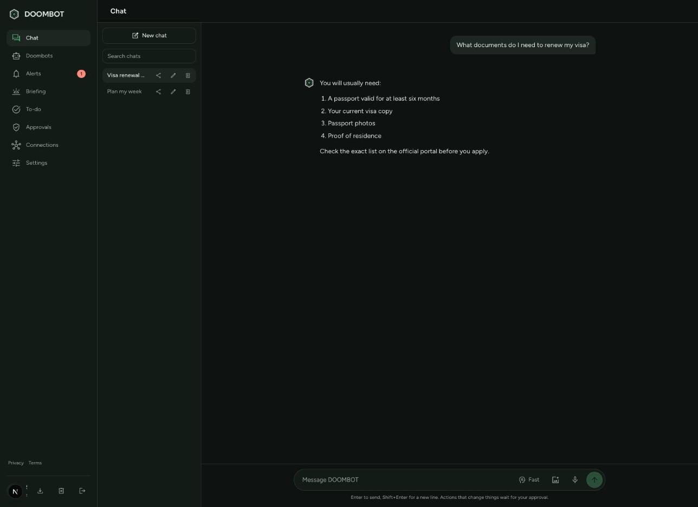
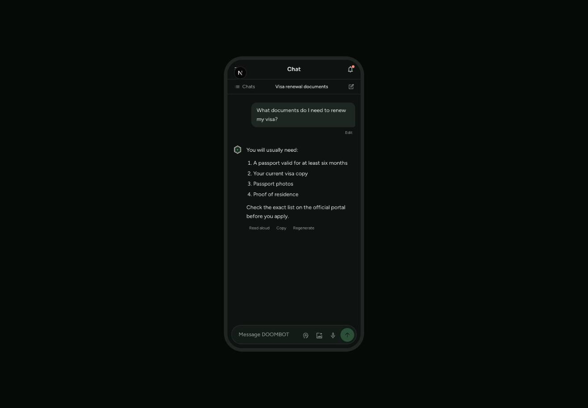
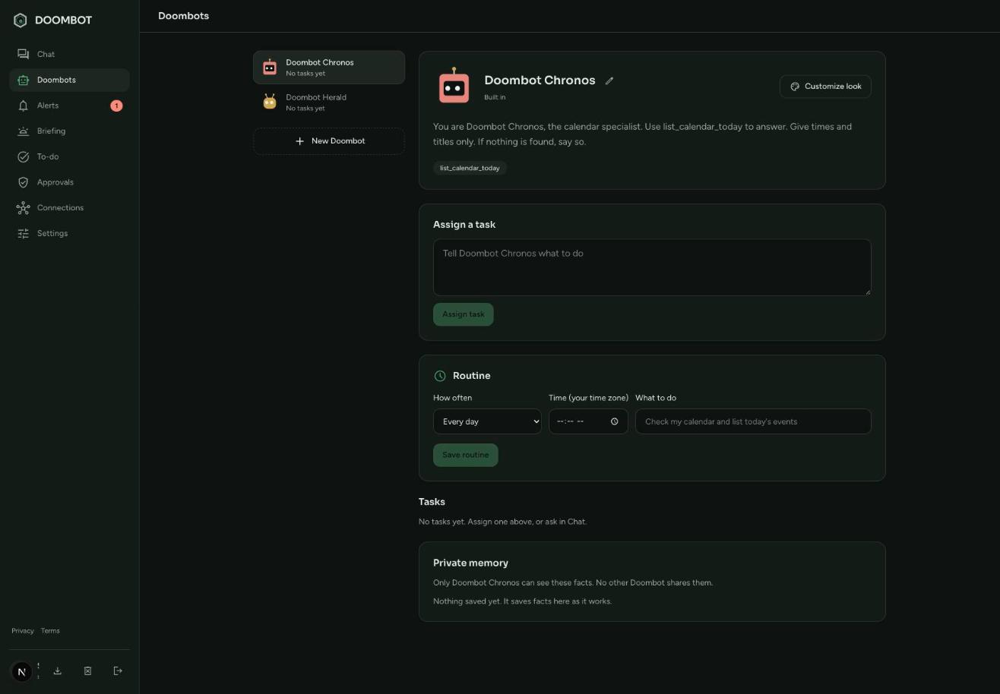
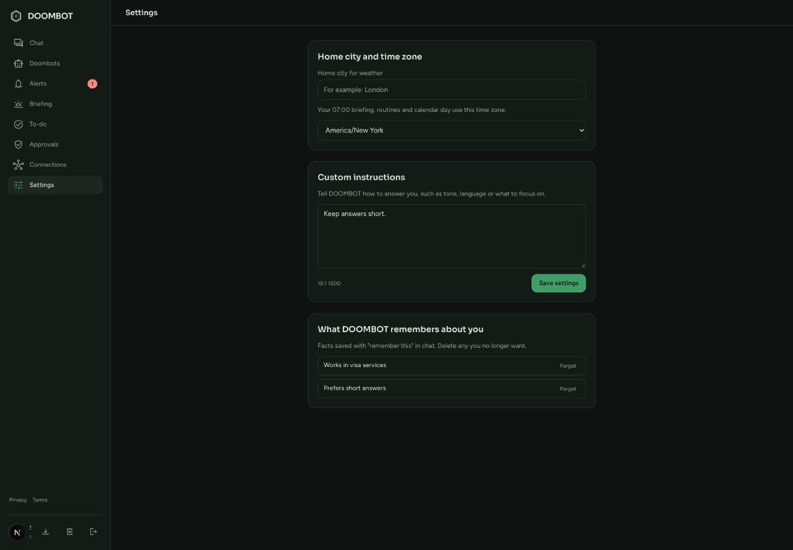

<div align="center">


# DOOMBOT

### A personal AI agent with a Doctor Doom theme, built to run free on the cloud

Chat that acts for you · [Live app](https://doom-bots.onrender.com/) · [Features](#features) · [Screenshots](#screenshots) · [Run it locally](#run-it-locally) · [Deploy free](#deploy-free-on-render-with-turso) · [Safety and privacy](#safety-and-privacy)

[](https://doom-bots.onrender.com/)
[](https://nextjs.org)
[](https://react.dev)
[](https://www.typescriptlang.org)
[](https://tailwindcss.com)
[](https://turso.tech)
[](https://render.com)
[](https://vitest.dev)
[](#install-on-your-phone-or-desktop)
[](./LICENSE)

<br>



</div>

---

## Overview

DOOMBOT is a chat agent that does things for you instead of only answering. It reads your calendar, mail and to-dos, searches the web, runs small helper agents called Doombots, and starts your day with a morning briefing. Before it changes anything, it shows you the action and waits for your answer.

This is the cloud version. It keeps all data in a Turso database, so it runs on free hosts that wipe their disk, such as Render's free plan.

Every person signs in with Google and gets a private account. Chats, Doombots, memories, to-dos, skills, alerts and Google connections are never shared between accounts.

## What it does

- **Answers and acts.** Ask in plain words. DOOMBOT uses its tools, then reports what it did.
- **Asks before it changes things.** Sending an email, deleting a to-do or saving a note waits for your approval, and you see the full text first.
- **Starts your day.** A briefing at 07:00 Dubai time with weather, headlines, calendar, unread mail and to-dos.
- **Runs a team.** Doombots have private memory, assigned tasks and routines that run hourly, daily, on weekdays, weekly or monthly.
- **Sorts your mail.** Ask what needs you, and it separates "Needs you" from "Can wait" with a reason for each.
- **Learns your habits.** Save your own skills and call them with `/name`.
- **Stays within a budget.** A daily token limit per account caps AI cost, and free backup providers take over when one runs out.

## Features

| Capability | What it means for you |
| --- | --- |
| Chat agent | Streaming replies with a stop button, multiple chats with search, edit and regenerate. |
| Approval step | Risky actions pause for **Approve** or **Deny**. Email approvals show the whole message before it is sent. |
| Send email | Doombot writes and sends one email from your Gmail, after you approve it. |
| Mail triage | Sorts up to 15 unread emails into **Needs you** and **Can wait**, with a one-line reason each. |
| Skills | Save named steps once in Settings, then run them in chat with `/name`. |
| Suggestions | The To-do page proposes up to 3 next steps from your to-dos, calendar and mail. **Start** opens a chat, **Hide** removes one. |
| Morning briefing | Weather, headlines on topics you pick, calendar, unread mail and to-dos at 07:00 Dubai time. |
| Doombots | Helper agents with private memory, assigned tasks and routines. Customize each one's look. |
| Google connections | Read-only Calendar, Gmail and Tasks, connected per account. Sending mail uses a separate permission. |
| Alerts | An alerts page, plus phone alerts with Web Push. |
| To-dos | A simple list that DOOMBOT and your Doombots can read and update. |
| Memory | Save lasting facts about you, view them, and delete any you no longer want. |
| Custom instructions | Set tone, language and focus, a time zone and a home city for each person. |
| Fast and Think | Switch between quick answers and deeper reasoning. |
| Attachments | Attach images and PDFs to a message. |
| Voice | Dictate with voice input and listen with read-aloud. |
| Share a chat | Send a read-only link. Share links expire after 30 days. |
| Web search | Looks up news, prices and scores, and names its sources. |
| Install as an app | Add it to your phone or desktop from the browser, with a launch screen and icons. |
| Product tour | A short walkthrough for new people. |
| Free hosting | Runs on Render's free plan with a free Turso database. |

## Screenshots

<table>
  <tr>
    <td align="center" width="50%">
      <br>
      <sub><b>Chat on desktop</b>: chats, search and an approval-aware composer</sub>
    </td>
    <td align="center" width="50%">
      <br>
      <sub><b>Chat on a phone</b>: the same agent, built for small screens</sub>
    </td>
  </tr>
  <tr>
    <td align="center" width="50%">
      <br>
      <sub><b>Doombots</b>: helper agents with tasks, routines and private memory</sub>
    </td>
    <td align="center" width="50%">
      <br>
      <sub><b>Settings</b>: instructions, memory, time zone and briefing topics</sub>
    </td>
  </tr>
</table>

## Install on your phone or desktop

DOOMBOT is a progressive web app. Open the live app, then use **Install app** in Settings or in the account menu, and it opens like a native app with its own icon and launch screen.

## Run it locally

You need Node 22.13 or newer.

```bash
npm install
cp .env.example .env.local
npm run dev
```

With the default `TURSO_DATABASE_URL=file:data/agent.db`, data is kept in a local file. Fill in `.env.local`, then open http://localhost:3000.

| Setting | What it is |
| --- | --- |
| `GROQ_API_KEY` | Main AI provider, running `openai/gpt-oss-120b` for fast replies. Has a free plan |
| `GEMINI_API_KEY`, `MISTRAL_API_KEY`, `OPENROUTER_API_KEY`, `DEEPSEEK_API_KEY` | Backups, used in this order when Groq fails. Gemini, Mistral and OpenRouter have free plans |
| `GOOGLE_CLIENT_ID`, `GOOGLE_CLIENT_SECRET` | Google OAuth client, used for sign-in and for Calendar, Gmail and Tasks |
| `AUTH_SECRET` | Random text of at least 32 characters that signs login cookies. Make one with `openssl rand -hex 32` |
| `APP_URL` | The public address of the app, with no trailing slash |
| `TURSO_DATABASE_URL`, `TURSO_AUTH_TOKEN` | The Turso database address and its token |
| `CRON_SECRET` | Random text of at least 16 characters that protects the `/api/cron` keep-awake endpoint |
| `DAILY_TOKEN_LIMIT` | Tokens each account may use per day |

## Checks

```bash
npm test
```

The tests cover token encryption, account privacy, sharing, the rate limit, chat history size, email sending checks, skills, mail triage and suggestions. GitHub runs them, plus type checks, lint and a build, on every push.

## Deploy free on Render with Turso

Render's free plan sleeps after 15 minutes without visitors and wipes its disk. Turso keeps the data, and a free cron job keeps the app awake so the 07:00 briefing and routines run.

### 1. Create the Turso database
1. Sign up at https://turso.tech (free, no card).
2. Create a database, for example `doombot`.
3. Copy its URL (it starts with `libsql://`) and create a database token.

### 2. Create the Render service
1. Sign up at https://render.com and connect your GitHub account.
2. Choose **New → Blueprint** and pick this repository. Render reads `render.yaml` and creates a free web service named `doombot`.
3. Fill in the values it asks for: `TURSO_DATABASE_URL`, `TURSO_AUTH_TOKEN`, the two Google values and the two AI keys.
4. After the first deploy, copy the service address, such as `https://doom-bots.onrender.com`. Set `APP_URL` to it and redeploy.

`AUTH_SECRET` and `CRON_SECRET` are generated for you. Copy `CRON_SECRET` from the service's **Environment** page for the next step.

### 3. Keep it awake with cron-job.org
1. Sign up at https://cron-job.org (free).
2. Create a job for `https://YOUR-ADDRESS/api/cron`, every 5 minutes.
3. Under advanced settings, add the header `Authorization` with the value `Bearer YOUR_CRON_SECRET`.

Each visit also runs any due briefings and routines, so nothing depends on the app staying awake in between.

### 4. Google Cloud OAuth
In your OAuth client, add these Authorized redirect URIs, using your own address:
- `https://YOUR-ADDRESS/api/auth/google/callback`
- `https://YOUR-ADDRESS/api/google/callback`

While the Google app is in Testing mode, only the test users you list can sign in. Reading Gmail for other people needs Google's app verification.

**Sending email needs the Gmail send permission.** If you connected Google before this feature existed, open **Connections** and connect Google again. Until you do, sending fails with a message that tells you to reconnect.

### Limits to know
- The first visit after a long idle can take about a minute while Render wakes the service.
- The free plan gives 750 instance hours a month, which covers one service running all month.
- The note-saving tool writes files to the server's disk, which Render wipes on restart. Those notes are not kept.

## Safety and privacy

- **You approve every change.** Actions that send, save or delete wait on the Approvals page, and the full text is shown first.
- **Email, calendar and web text is data.** DOOMBOT is told never to follow instructions found inside it.
- **Private accounts.** Nothing is shared between accounts, and you can erase all your data from Settings.
- **Encrypted tokens.** Stored Google tokens are encrypted, and the chat rate limit survives restarts.
- **Expiring links.** Share links stop working after 30 days.

Read the [Privacy](https://doom-bots.onrender.com/privacy) and [Terms](https://doom-bots.onrender.com/terms) pages in the app.

## How it is built

| Part | What it uses |
| --- | --- |
| App | Next.js 16 and React 19, written in TypeScript with Tailwind CSS 4 |
| Data | Turso, a libSQL database, so the app has no local state to lose |
| AI | Groq first, then Gemini, Mistral, OpenRouter and DeepSeek as backups |
| Google | OAuth sign-in, plus Calendar, Gmail and Tasks per account |
| Phone alerts | Web Push |
| Tests | Vitest, with lint, type checks and a build in GitHub Actions |
| Hosting | Render's free plan, kept awake by a free cron job |

## License

[MIT](./LICENSE)
